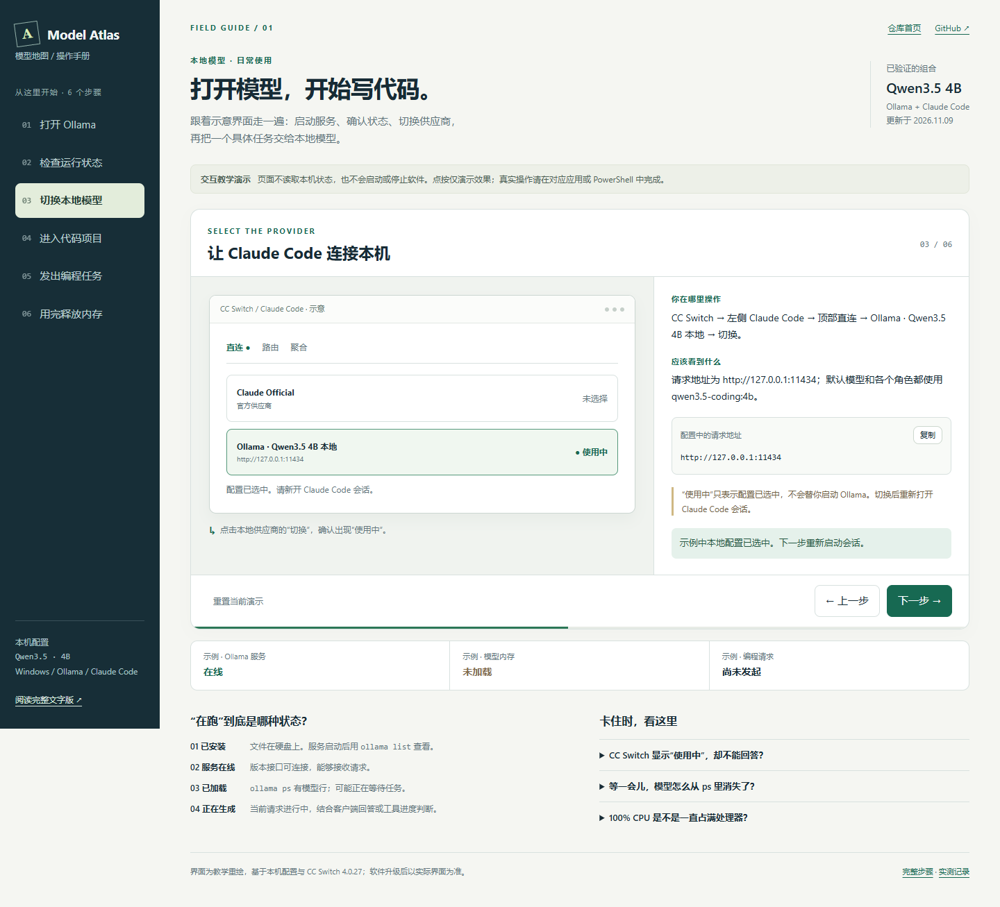

# 本地模型操作手册

适用：已完成本仓库安装的 Windows 电脑。配置基于 2026-11-09 实测，后续软件界面可能变化。

**现在可以直接操作：** 双击仓库根目录的 `Start-Console.cmd`，在本地控制台启动 Ollama、加载或卸载模型、发送真实问题。参见 [控制台说明](console.md)。下面保留完整的手动操作步骤。

**可点击演示：** [打开界面操作手册](ui-guide/index.html)。GitHub 会显示 HTML 源码；将仓库下载或克隆到电脑后，双击 `docs/ui-guide/index.html` 即可用浏览器离线打开。页面中的按钮只演示操作，不会启动软件或读取电脑的实时状态。



## 每次使用的顺序

1. 在 Windows 开始菜单搜索并打开 **Ollama**。
2. 打开 **CC Switch → Claude Code**，选择 **直连**，确认 **Ollama · Qwen3.5 4B 本地** 显示“使用中”。
3. 在项目目录打开一个新的 PowerShell，运行 `claude --model qwen3.5-coding:4b`。
4. 发送任务；模型按需加载，随后执行代码阅读或编辑。
5. 检查代码改动，运行项目测试。

模型已经安装好，日常使用不用重复执行安装和下载脚本。这里的 Claude Code 是操作项目的工具，实际生成回答的是本地 Qwen 模型。

## 1. 打开 Ollama

**界面操作：** Windows 开始菜单 → 搜索 `Ollama` → 打开。也可以在文件资源管理器打开 `D:\Software\Ollama\ollama app.exe`。程序可能在任务栏通知区域运行。

**应该看到什么：** 本地服务可以响应请求。打开应用不等于已经把模型加载到内存。

在 PowerShell 检查服务：

```powershell
Invoke-RestMethod -Uri 'http://127.0.0.1:11434/api/version' -TimeoutSec 5
```

返回版本号表示服务可连接。若仍提示“连接被拒绝”，先等待几秒再检查。桌面应用无法启动时，可在一个终端运行下列命令，并保持该终端打开：

```powershell
& 'D:\Software\Ollama\ollama.exe' serve
```

已有服务运行时不需要再执行 `serve`；“端口已被占用”可能意味着服务已经启动，应先检查版本接口。

## 2. 判断“模型在跑吗”

| 状态 | 怎么判断 | 意味着什么 |
| --- | --- | --- |
| 已安装 | 服务启动后，`ollama list` 能列出模型 | 权重文件保存在硬盘上 |
| 服务已启动 | `/api/version` 返回版本号 | Ollama 可以接收本机请求 |
| 模型已加载 | `ollama ps` 中有该模型 | 模型在内存中，可能正在等待请求 |
| 正在生成 | 当前请求尚未完成，客户端持续显示回答或工具执行进度 | 正在处理这一次任务；需要结合客户端观察 |

**`ollama ps` 有一行，不代表模型始终在计算；只有表头，也不代表硬盘上的模型文件被删除。**

```powershell
# 看已安装的模型；需要 Ollama 服务可用
& 'D:\Software\Ollama\ollama.exe' list

# 看当前加载到内存的模型
& 'D:\Software\Ollama\ollama.exe' ps
```

本机上次实测的输出示意：

```text
NAME                  SIZE      PROCESSOR    CONTEXT
qwen3.5-coding:4b      5.7 GB    100% CPU     65536
```

这是一条历史示例，不是当前状态。`100% CPU` 表示此模型使用 CPU/系统内存，而不是“CPU 使用率一直为 100%”。

默认情况下，Ollama 会在空闲约 5 分钟后释放模型内存，具体时间可由 `keep_alive` 或环境设置改变；下次请求会重新加载。它不会因此删除模型文件。[Ollama FAQ](https://docs.ollama.com/faq#how-do-i-keep-a-model-loaded-in-memory-or-make-it-unload-immediately)

## 3. 在 CC Switch 里选择本地模型

**界面路径：** 左侧 **Claude Code** → 顶部 **直连** → 找到 **Ollama · Qwen3.5 4B 本地** → 点击“切换”，看到“使用中”。

已有这个供应商时无需重复添加。需要核对配置时，点击该卡片的编辑按钮：

| 字段 | 本机配置 |
| --- | --- |
| 请求地址 | `http://127.0.0.1:11434` |
| API Key 占位值 | `ollama` |
| 上游格式 | Anthropic Messages（原生） |
| 默认兜底模型 | `qwen3.5-coding:4b` |
| 所有模型角色映射 | `qwen3.5-coding:4b` |

CC Switch 的“使用中”表示配置被选中，**不代表 Ollama 服务或模型已启动**。供应商切换后重新启动 Claude Code 会话。

若以后切回已配置好的远端供应商，在 CC Switch 选中它，再新开会话运行 `claude`；不要继续附带本地的 `--model qwen3.5-coding:4b`。远端供应商仍需有有效登录或凭据。

## 4. 打开项目并发出任务

下面以本仓库为例；实际写代码时将目录换成目标项目：

```powershell
Set-Location 'D:\GitHub\model-atlas'
claude --model qwen3.5-coding:4b
```

首次进入项目可能要求确认目录可信与编辑权限，按实际需要确认。先试一个范围明确的请求：

> 阅读 README.md，告诉我仓库有哪些安装和检查脚本。先不要修改文件。

需要修改代码时，明确文件名、期望行为和验证方法。例如：

> 阅读 strings.py，实现 normalize_names：去除首尾空格、删除空字符串、用 Unicode casefold 忽略大小写去重，保留首次出现的大小写和顺序，不改变输入列表。只修改该文件。

如果想复现已经验证过的编程任务，在仓库根目录执行：

```powershell
.\scripts\Test-ClaudeCode.ps1
```

脚本会创建独立测试目录并打印其路径。先检查该目录下模型生成的 `strings.py`，再运行同目录的 `test_strings.py`。基础链路检查脚本 `Test-Ollama.ps1` 会发送真实生成请求并加载模型；它不是只读的状态查询。

## 5. 用完怎么停

| 目的 | 操作 | 结果 |
| --- | --- | --- |
| 中断当前任务 | 在 Claude Code 中按 `Ctrl+C` | 停止本次交互；模型可能仍在内存中 |
| 暂时不用 | 结束会话并等待空闲超时 | 通常会自动释放模型内存 |
| 立即释放模型内存 | 在没有正在执行的任务时运行下方 `stop` 命令 | 服务继续运行，模型文件保留 |
| 完全停止 Ollama 服务 | 在通知区域的 Ollama 菜单选择退出；若用 `serve` 启动，则在对应终端按 `Ctrl+C` | 本地接口停止，下次需重新启动服务 |

```powershell
& 'D:\Software\Ollama\ollama.exe' stop qwen3.5-coding:4b
```

释放内存后可以运行 `ollama ps` 再确认。关闭 Claude Code 或 CC Switch 窗口不等于退出 Ollama 服务。停止模型命令参考 [Ollama CLI](https://docs.ollama.com/cli#stop-a-running-model)。

## 遇到问题时

| 看到的情况 | 下一步 |
| --- | --- |
| `127.0.0.1:11434` 连接被拒绝 | 打开 Ollama，检查版本接口 |
| `ollama ps` 只有表头 | 服务可能正常，只是没有模型驻留；发起一次请求后再看 |
| `model not found` | 检查 `ollama list`，必要时在仓库运行 `Initialize-Model.ps1` |
| `ollama` 不是可识别的命令 | 新开终端，或使用本手册给出的完整 exe 路径 |
| CC Switch 显示“使用中”，却不能回答 | 配置选中与服务状态是两回事，先检查 Ollama 服务 |
| 回答很慢 | 上次实测使用 CPU。先用单文件任务并等待首次加载，结合客户端进度判断 |
| 切换后仍连错服务 | 重新打开 Claude Code，并检查设置文件、项目配置和终端环境中是否有其他端点配置 |

2026-11-09 的真实代码编辑测试耗时约 95 秒，6 项测试通过。这只证明该小任务与工具链路可用，不是所有任务的速度或成功率保证。完整记录见 [实测结果](validation-2026-11-09.md)。

同日后续一次状态检查发现 Ollama 进程不存在、11434 接口拒绝连接，安装程序仍在。该次检查说明服务当时已经退出，无法判断退出原因；不影响此前安装和测试成功的事实，也不代表现在的实时状态。

[返回仓库首页](../README.md) · [首次安装与配置](windows-ollama-claude.md) · [官方 Claude Code 接入说明](https://docs.ollama.com/integrations/claude-code)
